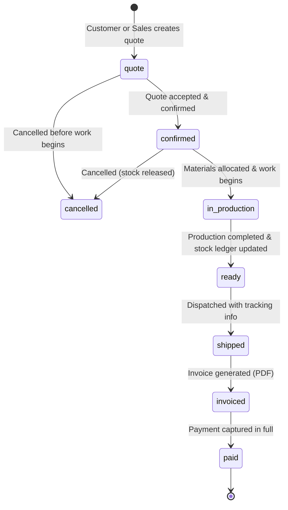
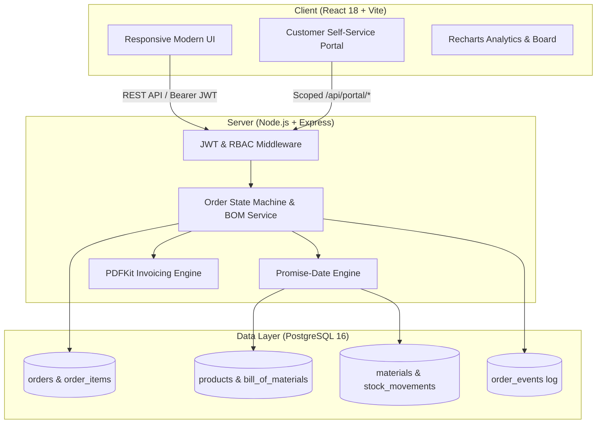

<div align="center">

# ⚙️ OrderCraft

### *Next-Gen Manufacturing Order Management & Promise-Date Engine*

**Know exactly when you'll deliver — and let your customers see it in real-time.**

[](https://react.dev/)
[](https://vitejs.dev/)
[](https://nodejs.org/)
[](https://expressjs.com/)
[](https://www.postgresql.org/)
[](https://www.docker.com/)
[](LICENSE)

[Live Features](#-key-features) • [Architecture](#-system-architecture) • [Quick Start](#-quick-start) • [Role Matrix](#-role-based-access-control-rbac) • [Demo Logins](#-demo-accounts)

</div>

---

## 📌 Overview

Most traditional ERPs and order management platforms are built exclusively for factory operators, leaving customer delivery dates to pure guesswork and endless back-and-forth email chains.

**OrderCraft changes that:** It couples a **mathematical Promise-Date Engine** (evaluating on-hand raw material inventory, FIFO reservation queues, supplier restock delays, and production assembly durations) with a **transparent Customer Self-Service Portal**. 

Manufacturers gain ironclad control over their margins and schedules, while clients gain clear, reliable delivery forecasts before committing to an order.

---

## ✨ Key Features

### 🏭 For the Manufacturer
* 🧠 **Smart Promise-Date Engine**: Calculates delivery deadlines using Bill of Materials (BOM), FIFO stock claim queues, manufacturing cycle times, and supplier replenishment lead times. Pinpoints the exact material causing any bottleneck.
* ⚠️ **Late-Risk Detection**: Automatically fires alerts whenever the calculated promise date overshoots the customer's requested delivery deadline.
* 📊 **Stock Ledger & True Gross Margin**: Computes real-time gross margin per order from an immutable `stock_movements` ledger based on actual raw materials consumed.
* 📦 **Automated Reorder Assistant**: Dynamic formula (`projected = on_hand - committed + on_order`) highlights shortfalls and generates supplier Purchase Orders with a single click.
* 🗓️ **Kanban & Production Scheduling**: Visual status pipelines and Gantt-style planning views for factory managers.
* 📈 **Analytics & Insights**: Live on-time delivery (OTD) percentage, revenue trends, margin breakdowns, top-selling products powered by **Recharts**, and one-click CSV report exports.
* 🛡️ **Full Event Audit Trail**: Every status transition, note, and update is logged immutably in `order_events`.

### 👥 For the Customer (Self-Service Portal)
* 📋 **Instant Quotes**: Request quotes online and review accurate delivery estimates before approving.
* 🚚 **Live Order Tracking**: Visual stepper timeline showing progress through production, quality check, and transit.
* 🔗 **Public Tracking Link**: Shareable tracking URL requiring no customer login (safely sanitizes cost and inventory data).
* 🏷️ **Tailored Pricing**: Customer-specific discount tiers applied automatically at checkout.
* 🧾 **Instant PDF Invoicing**: Download professional PDF invoices and receipts directly on demand.
* 🔁 **One-Click Reorders**: Repeat previous successful orders without re-entering configuration.

---

## 🔄 Order Lifecycle State Machine

OrderCraft enforces a strict finite state machine on the backend. Transitions can only advance in permitted sequence, ensuring inventory and financial consistency:



---

## 🏗️ System Architecture



---

## 🔐 Role-Based Access Control (RBAC)

OrderCraft provides granular role enforcement across both internal factory personnel and external clients:

| Role | Permissions & Scope |
| :--- | :--- |
| **Sales** | Manage customer profiles & portal logins; create, quote, confirm, and cancel pre-production orders. |
| **Planner** | Manage catalog products, Bills of Materials (BOMs), materials, suppliers, purchase orders, and production schedules. |
| **Warehouse** | Receive supplier PO shipments, update material stock levels, mark production complete, and ship orders. |
| **Finance** | Issue PDF invoices, record payments, and audit accounts receivable. |
| **Customer** | Scoped strictly to `/api/portal/*`. Manage personal quotes, view own orders, download invoices (cost & margin data stripped). |
| **Admin** | Full system-wide administrative access across all modules. |

---

## 🔑 Demo Accounts

The database comes pre-seeded with ready-to-test accounts representing each factory role and an external customer:

> **Default Password for all accounts:** `password123`

| Persona | Role | Email |
| :--- | :--- | :--- |
| **System Administrator** | `admin` | `admin@ordercraft.test` |
| **Sales Executive** | `sales` | `sales@ordercraft.test` |
| **Production Planner** | `planner` | `planner@ordercraft.test` |
| **Warehouse Manager** | `warehouse` | `warehouse@ordercraft.test` |
| **Finance Officer** | `finance` | `finance@ordercraft.test` |
| **Acme Corp Buyer** | `customer` | `customer@acme.test` |

---

## 🚀 Quick Start

### Prerequisites
* [Node.js](https://nodejs.org/) (v18.x or v20+)
* [Docker & Docker Compose](https://www.docker.com/) (or a local PostgreSQL 16 instance)
* [Git](https://git-scm.com/)

---

### 1️⃣ Clone the Repository
```bash
git clone https://github.com/Priyanshu2068/OrderCraft.git
cd OrderCraft
```

### 2️⃣ Start Database
Start a local PostgreSQL instance via Docker:
```bash
docker compose up -d
```
*(Alternatively, configure your own PostgreSQL database and update `server/.env`)*

---

### 3️⃣ Setup & Run Server
```bash
cd server
npm install

# Setup schema and populate demo fixtures
npm run migrate
npm run seed

# Start server in watch mode (runs on port 4000)
npm run dev
```

---

### 4️⃣ Setup & Run Frontend Client
In a new terminal window:
```bash
cd client
npm install

# Start Vite dev server (runs on http://localhost:5173)
npm run dev
```

Visit **`http://localhost:5173`** in your browser and log in with any demo account!

---

## 🧪 Testing

OrderCraft includes end-to-end integration tests verifying the full order-to-cash lifecycle, stock ledger calculations, customer portal security isolation, and report generation:

```bash
cd server
npm test
```

> **Note:** Tests perform real operations against the database referenced in `DATABASE_URL`. It is recommended to use a development database and re-run `npm run seed` afterwards.

---

## 📁 Repository Structure

```text
OrderCraft/
├── docker-compose.yml          # PostgreSQL 16 service definition
├── .gitignore                  # Git exclusions for dependencies and sensitive files
├── README.md                   # Project documentation
│
├── client/                     # Frontend Application (React + Vite)
│   ├── src/
│   │   ├── components/         # Reusable UI controls (Modals, Navbars, Badges)
│   │   ├── pages/              # App views:
│   │   │   ├── Dashboard.jsx   # Production metrics & revenue analytics
│   │   │   ├── Orders.jsx      # Order registry & filters
│   │   │   ├── OrderDetail.jsx # Deep dive: Promise dates, BOM status, Timeline
│   │   │   ├── NewOrder.jsx    # Quote creator with real-time lead-time calculation
│   │   │   ├── Board.jsx       # Kanban order status pipeline
│   │   │   ├── Planning.jsx    # Material stock projections & BOM editor
│   │   │   ├── Invoices.jsx    # Finance, invoices & payments
│   │   │   ├── Track.jsx       # Public tracking view
│   │   │   └── portal/         # Customer Self-Service Portal views
│   │   ├── api.js              # Centralized Axios/fetch client & JWT handling
│   │   └── styles.css          # Design system & responsive styles
│   └── package.json
│
└── server/                     # Backend API (Node.js + Express)
    ├── src/
    │   ├── db/                 # PostgreSQL pool, schema.sql, migration & seed scripts
    │   ├── middleware/         # JWT authentication, role guards, error handlers
    │   ├── routes/             # REST route handlers (orders, portal, operations, reports)
    │   ├── services/           # Promise-Date Engine, stock ledger & business logic
    │   ├── app.js              # Express app setup & security middleware
    │   └── server.js           # Server entry point (port 4000)
    ├── tests/                  # Automated integration tests
    └── package.json
```

---

## 🛡️ Key Architectural Rules

1. **Transactional Stock Ledger**: Inventory is never casually incremented or decremented; every change is an atomic record in `stock_movements` ensuring full traceability.
2. **Customer Isolation**: Customer accounts are strictly restricted to `/api/portal/*`. Internal unit costs, material stocks, supplier details, and manufacturer margins are strictly redacted from portal responses.
3. **Price Snapshotting**: `order_items.unit_price` captures an immutable snapshot of the product price at the exact moment a quote is generated.
4. **Shortage Guard**: Production cannot begin if required raw materials are missing from stock.

---

## 🤝 Contributing

Contributions, issues, and feature requests are welcome!

1. Fork the Project
2. Create your Feature Branch (`git checkout -b feature/AmazingFeature`)
3. Commit your Changes (`git commit -m 'Add some AmazingFeature'`)
4. Push to the Branch (`git push origin feature/AmazingFeature`)
5. Open a Pull Request

---

## 📄 License

Distributed under the **MIT License**. See `LICENSE` for more information.

<div align="center">
  <sub>Built with ❤️ by <a href="https://github.com/Priyanshu2068">Priyanshu</a> • Made for modern manufacturing excellence.</sub>
</div>
